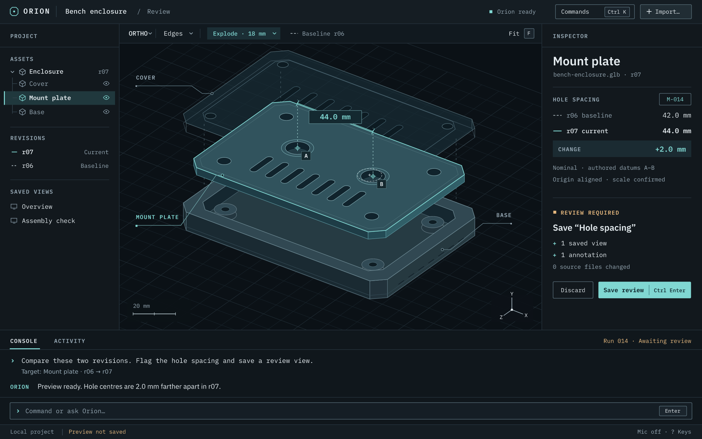

# Orion Workbench

A desktop-first 3D inspection and revision-review tool. The terminal-inspired workspace keeps the project tree, live model, measurements, and Orion command console in one place. Models and reviews stay in your browser by default.



## Run it

Use Node.js 22.12 or newer and a current desktop browser with WebGL2.

```sh
npm ci
npm run dev -- --host 127.0.0.1
```

Open **http://127.0.0.1:5173**. For the production web build, run `npm run build` then `npm start` and open **http://127.0.0.1:4173**. `HOST` and `PORT` override the production server's bind address. No account, rendering service, or Orion credentials are required.

## Public demo deployment

`npm run build:demo` produces a static build in `dist/demo/` that works under a GitHub Pages project URL. It includes the reference enclosure and runs in local-engine mode. Imported files and reviews stay in the visitor’s browser; the demo has no Orion server connection.

[Publish Orion demo](.github/workflows/orion-demo.yml) publishes only from `arena/964109c0-holographic-simulation`, after an owner selects **Settings → Pages → Source → GitHub Actions**. If Pages is not enabled, the workflow verifies the static build and skips deployment. To publish after changing that setting, re-run the latest **Publish Orion demo** workflow. An owner can unpublish the site in Pages settings.

## From model to review

1. **Try the sample.** The initial *Bench enclosure* project shows a review for the mount plate. Open `M-014` to inspect the authored points behind **42.0 → 44.0 mm (+2.0 mm)**. Save or discard the preview. Saved views in the left pane reopen their camera, revisions, and evidence.
2. **Inspect your own model.** Choose **Import…** or drop a `.glb` or `.stl` into the viewport. Use the project name menu to start a separate project. Select a part in the tree or model, then fit, hide, isolate, explode, or section it. These operations never modify the source file.
3. **Compare revisions.** Use **Import as → New revision** to add a second file to the same asset. Pin the older file as the baseline. Side by side uses a synchronized camera, with baseline on the left. Use **Overlay shared origin** only if the files share an origin and orientation.
4. **Measure and verify.** Confirm scale against a known dimension first. Use the ruler menu to pick two mesh points or enter coordinates in the workbench's Y-up model frame. Mesh picks are approximate. For a user-defined comparison, measure both revisions and use **Compare A/B pairs** to confirm that the points mark the same features.
5. **Keep or hand off the result.** Save a view directly, or type `compare these revisions and prepare a review view` to stage a review. Save, discard, or reopen its original scope without changing geometry. **Export** downloads the annotated viewport PNG or a JSON record with evidence, view settings, and source metadata. The filename in the inspector opens source details and original-file download.

**Controls:** drag to orbit, right-drag to pan, scroll to zoom. `Ctrl/⌘ K` opens the palette, `F` fits, `I` isolates, `M` starts point picking, `/` focuses the prompt, and `?` shows the full key map. Use arrows (Shift to pan) while the viewport has focus. Drag a pane divider or focus it and use the arrow keys to resize. Direct commands such as `view top`, `fit all`, `save view`, and `undo` work without a connector.

## Storage and format limits

- Saved views and original imported bytes use IndexedDB, scoped to the same browser profile and app origin. Preview URLs and localhost have separate storage. Use a stable local URL for long-lived projects, and export records or keep the original files separately. A review JSON is a handoff record, not a portable project archive.
- If storage is blocked, full, or another tab has saved a newer checkpoint, your edits remain in that tab as **Session only** rather than overwriting the saved workspace. Export what you need before closing or reloading that tab.
- Import supports static, triangulated, self-contained glTF 2.0 Binary (`.glb`) with embedded PNG/JPEG textures, and binary or ASCII STL. GLB uses metres and Y-up; choose source units and the up axis for STL. Limits include 75 MiB per file, 500,000 triangles including instances, 250 mesh definitions, and 4,096 pixels per texture side. Export compressed GLB, rigged/animated models, or models with external resources as static, uncompressed, self-contained GLB first.
- The workbench measures distances in the review mesh or between entered coordinates. It is not a tolerance/fit checker, a parametric CAD editor, or a physical holographic display. STEP, catalog downloads, voice, and spatial hardware integrations are outside this build. Import only files you own or have permission to use; optional provenance fields are retained on export.

## Optional Orion runtime

**Local engine** uses a small deterministic project command grammar, not a live AI service. To connect your own Orion adapter, see [the HTTP contract](docs/orion-engineering.md#running-implementation). Configure its endpoint server-side with `.env.example` as a template, then explicitly opt in for that destination in **Workbench settings**. Only the prompt and scoped labels/flags are sent. Model bytes and screenshots stay in the browser. The optional connector token stays on the server. Manual inspection remains available if the connector fails.

## Verify

```sh
npm test
npm run build
npx playwright install chromium
npm run test:e2e
# Test the built server instead of Vite (run npm run build first):
PLAYWRIGHT_PRODUCTION=1 npm run test:e2e
```

The tests cover GLB/STL validation, model-space transforms, point measurements, revision pairing, review save/discard/reload/undo, exports, keyboard and narrow layouts, cancellation and storage conflicts. Connector tests use a controlled stub; they do not validate a real Orion deployment. `PLAYWRIGHT_CHROMIUM_EXECUTABLE` can point at an installed Chromium, and `PLAYWRIGHT_BASE_URL` can target an already running workbench.

[Research and product design](docs/orion-workbench.md) · [Engineering decisions and release gates](docs/orion-engineering.md) · [Editable design](docs/design/orion-review.svg)
