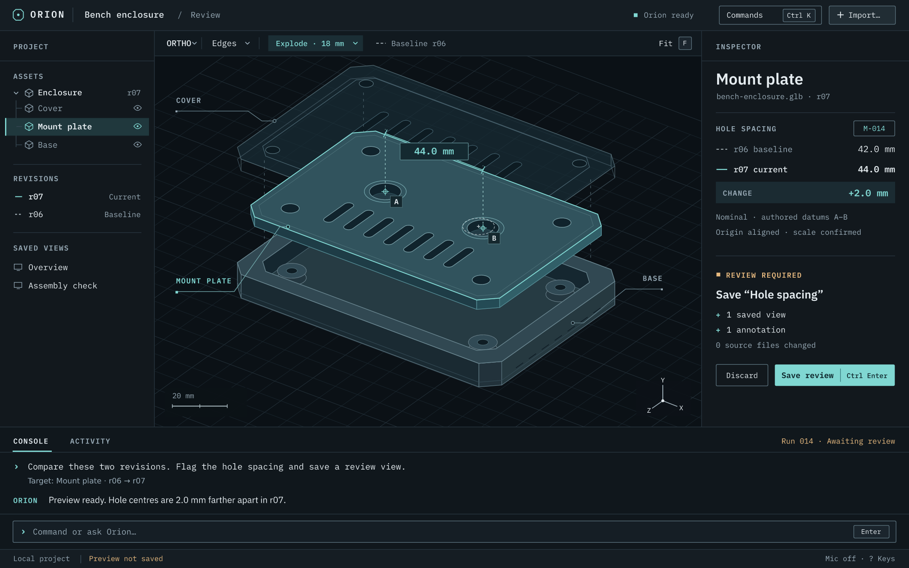

# Orion Workbench

**Research & product plan · 18 November 2026**

*A keyboard-first workspace for inspecting 3D models and doing project work with Orion.*

**Build a terminal-style workbench around a real 3D viewport.** Put the project tree on the left, evidence and proposed changes on the right, and the Orion command line at the bottom. Make model inspection useful before connecting the AI. The Stark-like moment is selecting a part, saying *“Compare this to the previous revision,”* and seeing the answer appear on the geometry while you keep working. It isn’t having to wave at your desk to zoom in.

Start on an ordinary monitor. Make the holographic look an inspection mode; make actual spatial hardware an optional second display.

[Open the visual mockup](design/orion-review.png) · [Engineering plan, contracts, and release gates](orion-engineering.md)

The desktop workbench is now runnable; see [launch instructions and verified scope](../README.md). The research and release sequence below describe the design target and later validation gates.

## 1. What Stark’s display actually does

There is no working projection system to reverse-engineer from the films. There are, however, two documented pieces of interface design worth separating:

| Film reference | How the effect was made | What Orion should take from it |
| --- | --- | --- |
| **Iron Man (2008), helmet HUD** | The Orphanage team describes tracking and animating to Downey’s head and eyes, adding some lag to the graphics, stacking graphics at different depths for parallax, and reprojecting the HUD into eye reflections. They found that audiences didn’t need the explicit eye cursor in the test to follow the interaction. [1](https://vfxblog.com/ironman/) | Give camera movement weight and use depth to express spatial relationships. Don’t build gaze tracking for the desk; show what’s selected when the user or agent needs to know. |
| **Iron Man 2 (2010), workshop / Stark Expo model** | Prologue’s Danny Yount describes previs for the discovery sequence, then matchmoving, tracking, compositing, and graphics animated to cue. Paul Mitchel describes matching Tony’s eyeline and arm reach and balancing detail against legibility. The look used contour shading and vertex-attached particles. The film’s apparent real-time response was choreographed, not a working free-air display. [1](https://www.artofvfx.com/iron-man-2-danny-yount-directeur-artistique-prologue/) [3](https://motionographer.com/2010/05/25/prologue-iron-man-2/) | Let the same object move from overview to isolated part to measured detail. Every transition should explain a change in state. Swap decorative particles for edges, cut planes, baselines, and point markers with actual meaning. |

**The implied interaction loop:** Tony points or names a subject, JARVIS interprets the request, and the scene changes right where Tony is looking. In Orion that becomes **select → ask → inspect evidence → save or discard**. The selection resolves what “this” means; the model understands the wording; deterministic tools do the measuring. That last part is a design choice, not something the films specify.

### What real interaction research changes

- **Use direct manipulation for exact, reversible work.** Shneiderman’s account emphasizes visible objects and rapid, incremental, reversible actions. Use that for navigation, clipping, visibility, and picking. None of those should require a round-trip to the agent. [1](https://www.cs.umd.edu/~ben/papers/Shneiderman1983Direct.pdf)
- **Pair speech with a real referent.** Richard Bolt’s *Put-That-There* showed how pointing gives meaning to spoken pronouns. In Orion the referent is a visible, locked selection or two explicitly pinned revisions—not whatever the cursor happens to cross after you speak. [1](https://www.media.mit.edu/speech/papers/1980/bolt_SIGGRAPH80_put-that-there.pdf)
- **Reserve mid-air input for short, coarse actions.** The CHI *Consumed Endurance* study documents arm fatigue in repetitive mid-air tasks. HoloDesk showed interesting reach-in manipulation with a half-silvered mirror and Kinect aligned to a viewer; it did not eliminate the need for an optical setup. Test pinch/select and reposition only if a spatial view proves useful; use the keyboard, pointer, or numeric fields for sustained work. [1](https://hci.cs.umanitoba.ca/assets/publication_files/Consumed_Endurance_-_CHI_2014.pdf) [1](https://www.microsoft.com/en-us/research/publication/holodesk-direct-3d-interactions-with-a-situated-see-through-display/)
- **Make the agent easy to correct and dismiss.** Amershi et al.’s human–AI guidelines call for efficient correction and dismissal, narrowing action when uncertain, and explaining results. Make those actions concrete: click the cited measurement, change the target, discard the preview, or keep operating manually. [1](https://www.microsoft.com/en-us/research/wp-content/uploads/2019/01/Guidelines-for-Human-AI-Interaction-camera-ready.pdf)

## 2. What “holographic” should mean for Orion

Optical holography reconstructs a light wavefront. A rendered 3D object, a reflected image, and a glasses-free multiview display can all suggest depth without doing that. Reserve *wavefront holography* for the optical process. [1](https://www.nobelprize.org/uploads/2018/06/gabor-lecture.pdf) [3](https://www.nobelprize.org/stories/holograms/)

| Output | What you actually see | Orion decision |
| --- | --- | --- |
| **Monitor / WebGL viewport** | Rasterized 3D geometry with perspective or orthographic views, occlusion, shading, edge overlays, and motion parallax as you orbit. No stereo or free-air image. | **Build first.** All editing, dimension reading, keyboard work, and reviews are supported here. No new hardware. |
| **Mixed reality headset** | A virtual stereo object placed against a view of your room. WebXR exposes immersive AR sessions where supported; hit testing, depth, anchors, and hand input vary by device and browser. [1](https://www.w3.org/TR/webxr/) [5](https://www.w3.org/TR/webxr-depth-sensing-1/) | Try later if *in-room scale* or placement matters. Open one tabletop model, place/recenter it, and keep text-heavy work on the monitor. |
| **Glasses-free multiview panel** | A display such as Looking Glass sends different perspective views into a viewing cone. Its SDK packs views into a **quilt** and uses its Bridge software for display output. It’s a bounded display, not a room-scale projection. [3](https://docs.lookingglassfactory.com/keyconcepts) [2](https://docs.lookingglassfactory.com/software/looking-glass-bridge-sdk/integrating-native-applications) | Try later if *several people at a desk* need to understand depth. Keep controls and dense labels on the regular monitor. Borrow a unit before committing to an integration. |
| **Reflection illusion (Pepper’s Ghost)** | A reflected image appears to float in a viewing setup; a simple screen-and-reflector rig does not provide geometry-correct views from arbitrary positions. [3](https://www.nobelprize.org/stories/holograms/) | Fine for a demo, not a day-to-day workspace or a reason to redesign Orion. |
| **Volumetric and wavefront displays** | These are distinct research paths. Smalley et al. moved and illuminated a trapped particle in a physical volume; Shi et al. built a near-eye wavefront prototype with optical field-of-view and eyebox tradeoffs. Neither is the movie’s large, bright, shared desk display. [4](https://www.nature.com/articles/nature25176) [1](https://cdfg.mit.edu/pdf/journal/2017-shi-near-eye-light-field-holographic-rendering-with-spherical.pdf) | Out of scope. If true free-air rendering is required, treat that as a separate hardware project, not an Orion milestone. |

**Keep space where it helps.** Use 3D for relationships: what sits behind what, where pieces mate, what changed, where a measurement starts and ends. Use flat text for exact values, job status, file provenance, and decisions. Don’t float UI panels around the user’s head.

## 3. The work loop

### A first job: compare two versions of a bench enclosure

1. **Bring in the designs.** Export a self-contained `.glb` from your design tool, or download one you’re allowed to use. Drop it into the project, or choose **Import…**. See its source, import warnings, declared units, and scale status. Add the second file **as a new revision** rather than overwriting the first. If you started with a Blender project, use its glTF 2.0 export; this is a review copy, not the editable source. [1](https://docs.blender.org/manual/en/latest/addons/scene_gltf2.html)
2. **Set the scope.** Pick **Mount plate** from the tree or the viewport and pin `r06` as baseline against `r07`. Use an authored common datum or confirm a shared source origin. If the origins differ and no alignment has been entered, use side-by-side views; don’t silently overlay or auto-rescale. Clip, explode, or isolate as needed. These operations change the view, not the source geometry.
3. **Give Orion the intent.** Type *“Compare these two revisions. Flag the hole spacing and save a review view.”* The console shows `Mount plate · r06 ↔ r07` at submission. If either hole centre is missing, Orion asks you to place or confirm a point on each revision; it doesn’t claim it can infer exact hole centres from arbitrary triangulated geometry.
4. **See the answer on the object.** For the planned sample, authored centres `A` and `B` give `42.0 mm` at `r06`, `44.0 mm` at `r07`, and a `+2.0 mm` delta. The live callout, baseline markers, and inspector all point to the same evidence. A result from clicks on a generic mesh would instead be labelled **Approx.**. No claim about fit or manufacturing tolerance follows from the render.
5. **Keep a review you can reopen.** The preview lists `+1 saved view`, `+1 annotation`, `0 source files changed`. Keep orbiting or inspecting while it waits. **Save review** commits the proposed view and annotation together; **Discard** leaves the project unchanged. Reopening the review restores the pinned model revisions, measurement, camera, and original review pose. Undo creates a new history entry; the imported files remain untouched.

### Where Orion helps vs. where it stays out of the way

| I want to… | Default interaction |
| --- | --- |
| Find a part, frame it, hide neighbours or change orientation | Tree or viewport pick; named command (`fit`, `isolate`, `view front`); no AI. |
| Slice open a case, separate an assembly, measure known points | Direct control plus numeric input; all presentation-only. Numbers come from the geometry tool, not the transcript. |
| Turn a question into several steps | Ask Orion. It can inspect approved project context, run read tools, and stage a view or note while I work. The activity pane shows which step is running and lets me stop it. |
| Resume work tomorrow or hand off a review | Reopen the last view or a named one. Export a user-selected PNG with view metadata and a plain-text/JSON review record; include revision IDs and attribution where known. No background publishing. |
| Speak without reaching for the keyboard | After desktop validation, optional push-to-talk with visible target and editable transcript; no always-on mic. Use speech for intent, not approval or precision data entry. |

Once this loop works for 3D, extend the same scoped actions to other project work: find an attached drawing, turn review findings into a checklist, or propose a handoff note tied to a saved view. Don’t add a separate chat workspace or a general shell-agent mode just to support those tasks.

## 4. Visual direction: an instrument, not a dashboard

*Design target: a pending review in the `Bench enclosure` project. The values are for the sample scenario. This is a static mockup, not a running app.* [Open full size](design/orion-review.png) · [Editable vector](design/orion-review.svg).

- **Layout at 1440 × 900.** A 48 px project bar, ~244 px tree, ~328 px inspector, the full remaining width for the viewport, and a ~194 px console dock over a 30 px status strip. The bottom dock collapses to the input line. Panels are resizable. Below ~1100 px, use a toggleable inspector rather than letting the viewport collapse. On a narrow display, switch between scene and details without losing the target or prompt.
- **Terminal grammar, modern native-feeling inputs.** Flat panes, one-pixel rules, square controls, tidy aligned rows. IBM Plex Mono (or system monospace) for paths, commands, revisions, and tabular values. IBM Plex Sans (or system UI) for longer sentences and the inspector heading. 13–14 px body, 11–12 px secondary labels, 24–28 px default tree rows, scalable type and comfortable-density option. The references are Lazygit’s scoped panes and inspect-before-stage flow plus Blender’s direct viewport controls—not a film-shaped skin over chat. [1](https://github.com/jesseduffield/lazygit) [1](https://docs.blender.org/manual/en/latest/editors/3dview/introduction.html)
- **A deliberately small palette.** `#12181D` panel, `#0B1116` viewport, `#27343E` decorative dividers, `#E4EBEF` primary text, `#97A9B5` muted text, `#80D7D2` selection/focus, `#E5B87E` pending or caution, `#F0908D` error. A selected row has a leading mark and stronger type; a pending review says **Review required**. Color never carries meaning by itself. Use stronger outlines for interactive controls than for decorative dividers.
- **Three display styles, different jobs.** **Solid** is the readable default. **Edges** gives hard surfaces a subdued shaded fill and uses feature edges rather than wireframing every triangle. **X-ray** deliberately reveals hidden structure: thinner, lower-contrast or dashed occluded edges, visibly labelled mode. In compare, mark current and baseline with both line style and revision labels. Add a real grid, axes and units; name what they mean. Turn off any overlay that doesn’t help answer the current question.
- **Motion explains actions.** A short ~120–180 ms fit or explode transition may show where a selected part moved. Selection is immediate; no auto-orbit, animated idle UI, background scanlines, neon bloom, glass cards, decorative telemetry, fake shell output, or “AI orb.” Reduced-motion mode snaps to the result. An empty project shows one import action, not an inactive imitation of a busy control room.

### What changes when work is blocked

| State | What the user sees and can do |
| --- | --- |
| New or blank project | Keep the same panes, no fake assets. Centre: **Drop a GLB here** or **Choose file**. Below: a link to one small sample with known dimensions. |
| Importing or running | Keep the current viewport usable. Show the actual stage in Activity (`Validating GLB`, `Reading two revisions`), with **Cancel**. Use determinate progress only when there’s a known total. Don’t move focus when a background step finishes. |
| Missing reference or unknown scale | Highlight the affected part and show a concrete next action in the inspector: **Set point B on r06** or **Confirm scale**. Keep the prompt and target pinned while the user supplies it. |
| Review ready or stale | Show the geometry and the proposed changes together, as in the mockup. A stale review keeps its evidence visible but replaces **Save review** with **Regenerate against current project**. |
| Offline or renderer unavailable | Keep manual project operations available when Orion is offline. If the GPU is unavailable, keep the tree, units, notes, and saved views readable alongside an explicit **Retry viewport** action. |

### Keyboard and accessibility

| Key | Behavior |
| --- | --- |
| `Ctrl/⌘ + K` | Search commands. Each entry names what it acts on. Also available from a visible button. |
| `Tab` / `Shift + Tab`, then arrow keys in the tree | Normal focus order; arrows navigate the active tree. No canvas trap; focus is always drawn. |
| `F` / `I` / `?` (outside text entry) | Fit selection (or all if none), toggle isolate on the current selection, show keys. Remappable or disableable. |
| `Esc` | Close the top overlay or cancel the active viewport tool. Never implicitly accepts or discards a pending review. |
| `Ctrl/⌘ + Enter` | Save only when focus is in an eligible review. In the console, `Enter` runs the typed request. A visible button covers both actions. |
| `Ctrl/⌘ + Z` (outside text entry) | Undo the last workbench edit; never undo text or conflate camera history with project history. |

Keep an HTML tree, inspector, measurement list, and live status region even though the model is rendered in a canvas. Offer view presets and buttons/numeric controls as alternatives to dragging; allow selecting or entering measurement anchors without relying on a visual pick. Announce milestones rather than streaming every token, and restore focus after transient dialogs. Verify WCAG 2.2 keyboard, focus, contrast, and drag-alternative requirements during build, not after the UI is fixed. [1](https://www.w3.org/WAI/standards-guidelines/wcag/new-in-22/) [4](https://www.w3.org/WAI/WCAG22/Techniques/)

## 5. Release order

| Cut | Build | It ships when… |
| --- | --- | --- |
| **0 · Define** | Pick a representative project and normal workstation; confirm Orion’s existing request/stream/cancel interface; create the r06/r07 fixture with known dimensions; time the current comparison workflow. | There is a baseline and one testable use case. Nothing requires hardware. |
| **1 · Inspect** | Local projects, static self-contained GLB import (including files downloaded elsewhere), tree, orbit/fit/isolate, solid/edges, point measurements, persistent views. Start with a real model and a thin command palette, not a mock dashboard. | Import → select → measure → save → reopen works without Orion, internet, or a mouse-only step. |
| **2 · Review** | Two-revision compare, clipping/explode, X-ray, pinned context, typed Orion run with tool evidence, preview/apply/undo, activity and cancellation, review export. Build with a deterministic test adapter before wiring the actual runtime. | A real Orion request completes the comparison on the fixture; ambiguous choices don’t mutate state, and the wrong/stale proposal cannot be applied. Compare the workflow against the baseline before adding more tools. |
| **3 · Expand by need** | Prioritize unit-confirmed STL or STEP if real projects need them, licensed catalog import if downloads are frequent, opt-in voice if it beats typing, and **one** spatial output if it improves a real review task. | Each addition earns its place with the same workflow benchmark. Core inspection stays independent of headsets, voice, and model provider. |

**Planning estimate:** 3–5 focused weeks for a single-user desktop pilot with one developer, assuming a callable Orion runtime and a small representative GLB corpus. Re-estimate after cut 0. An RGB-D rig, CAD authoring, automatic assembly fit analysis, onboarding screens, long-running general-purpose autonomy, and cloud collaboration are not pilot work.

**First build ticket:** Import one real `bench-enclosure.glb`, frame **Mount plate** from the keyboard, measure between two known points, and save/reopen that view. Then introduce the r06/r07 comparison. If this isn’t faster than opening a conventional viewer, don’t put a voice command on top of it yet.

[Continue to the engineering plan →](orion-engineering.md)
